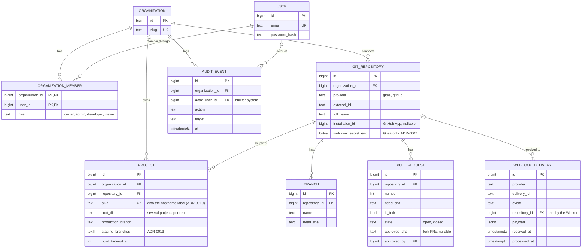
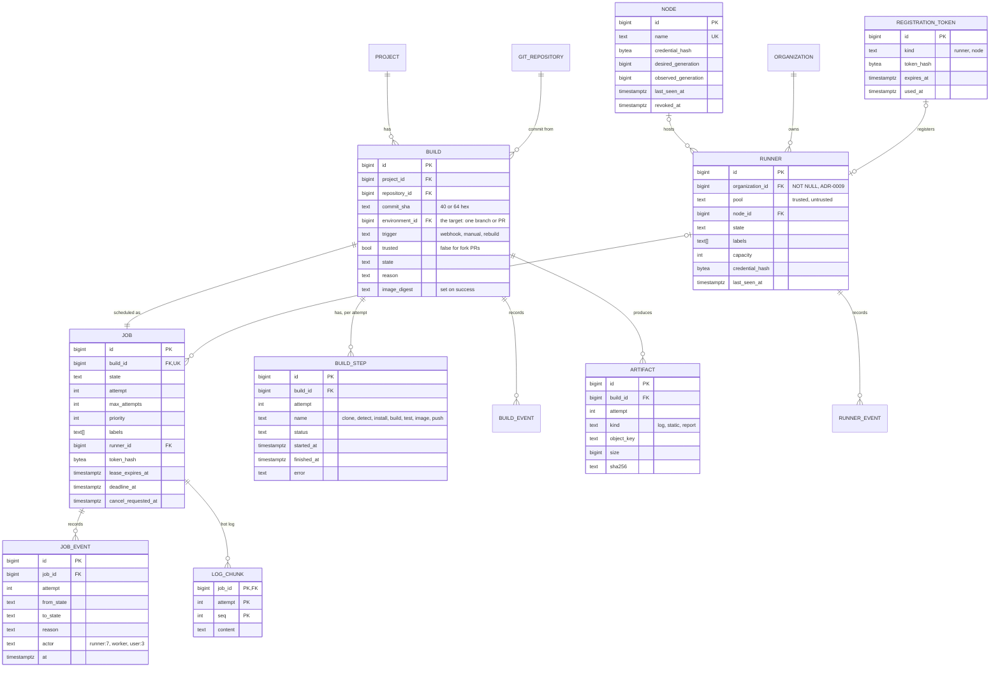
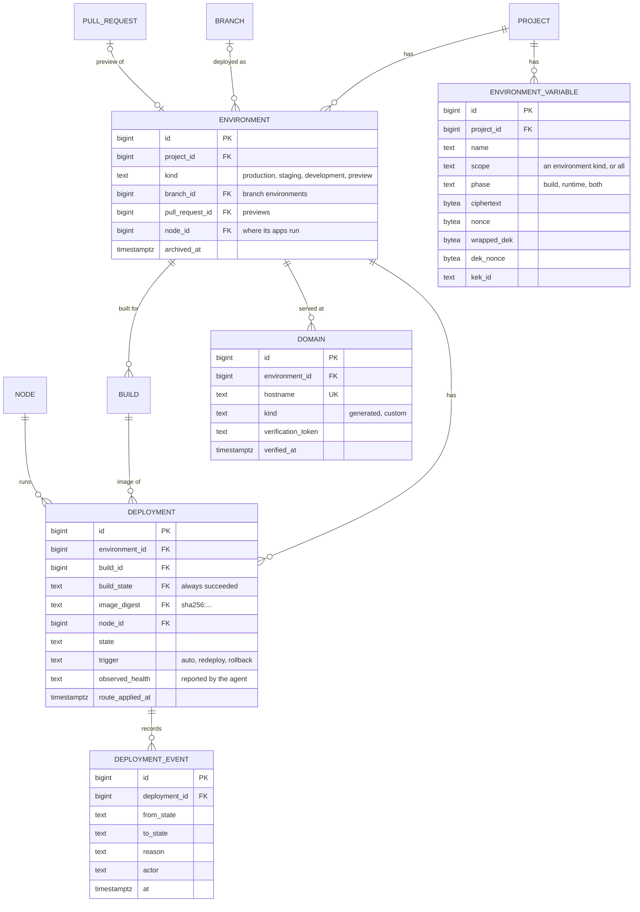

# Data model

Status: accepted 2026-11-06 (Gate B part 2 of 3). Amended 2026-11-06 by part 3: every runner has an organization and a pool (ADR-0009); `project.staging_branches` (ADR-0013). Amended 2026-11-06 by Gate C part 1: builds belong to an environment, more composite keys, installation-wide project slugs.
Column lists show keys and the columns that rules depend on. The full DDL is `control-plane/migrations/0001_initial.sql`.

The entities come from `docs/spec.md` section 6. Four additions, all `[OUR DECISION]`:

- **Environment**: where a project deploys to. That is its production branch, a staging branch, or one preview per PR. Deployments, domains and the "one live deployment" rule hang off it. Without it, a Deployment would need two optional parents (a branch or a PR).
- **Node**: one machine running the agent. The protocol already addresses nodes (`/v1/nodes/{id}`), and the agent has its own credential (ADR-0005).
- **RegistrationToken**: the one-time tokens for runners and nodes (spec 16).
- **BuildEvent, JobEvent, RunnerEvent**: the spec names DeploymentEvent. Every state machine gets the same kind of append-only table (`state-machines.md`).

Not shown: `user_session`, `api_token` and `state_transition` (`control-plane/migrations/0001_initial.sql`).

## 1. Tenancy and Git

`WEBHOOK_DELIVERY.repository_id` is nullable. A GitHub App sends all repositories' events to one URL, signed with one secret, so the repository is known only after the Worker reads the payload.

## 2. Builds and scheduling

BUILD_EVENT and RUNNER_EVENT have the same columns as JOB_EVENT, without `attempt`. DEPLOYMENT_EVENT is in diagram 3.

## 3. Deployments and configuration

Which branch types deploy, and with which limits, is ADR-0013. Development branches build and test but never deploy.

## 4. Constraints

| Rule | Database enforces it with | Code enforces it with |
|---|---|---|
| A build references a project, a repository and an exact SHA (spec 6) | `NOT NULL` foreign keys; `CHECK (commit_sha ~ '^[0-9a-f]{40}([0-9a-f]{24})?$')` (SHA-1, or SHA-256 repositories) | the Worker resolves the SHA from the provider (ADR-0004), never a branch name |
| A deployment references a successful build, its digest and the environment it was built for (spec 6, D1) | composite foreign key, explained below | none needed |
| A webhook delivery is unique per provider delivery ID (spec 6) | `UNIQUE (provider, delivery_id)` | the intake still answers 2xx on a conflict (ADR-0004) |
| One webhook build per project, target and SHA (ADR-0004); the environment is the project plus its target | partial `UNIQUE (environment_id, commit_sha) WHERE trigger = 'webhook'` | insert, on conflict do nothing |
| No two active jobs for the same build (spec 6) | `UNIQUE (build_id)` on job: one job row per build, attempts counted inside it (ADR-0003) | none needed |
| One live deployment per environment (spec 11) | partial `UNIQUE (environment_id) WHERE state = 'live'` | the switch demotes the old one first (`state-machines.md`, D2) |
| Only legal state transitions (spec 6) | `CHECK` on state values; a trigger rejects any (old, new) pair missing from an allowed-transition table | compare-and-set updates (`state-machines.md`) |
| Every transition is recorded (spec 6) | event rows are insert-only for the app role (grants) | the transaction that changes the state inserts the event row; an M2 test compares counts |
| Secrets are never stored in plaintext (spec 6) | no plaintext column exists; `CHECK (octet_length(nonce) = 12)` | envelope encryption (ADR-0007) |
| Retries keep the history of earlier attempts (spec 6) | `attempt` is part of the key of steps, log chunks and log archives | event rows are insert-only; a rebuild is a new Build and Job |
| One environment per branch or PR | `CHECK (num_nonnulls(branch_id, pull_request_id) = 1)`; `UNIQUE (project_id, branch_id)`; `UNIQUE (project_id, pull_request_id)` | none needed |
| Links stay inside one tenant | composite foreign keys: a project uses a repository of its own organization; a build uses an environment of its own project | none needed |
| Credentials are stored only as hashes | columns hold SHA-256 hashes, never the token | tokens are shown once, at creation |

How the deployment foreign key works `[OUR DECISION]`:

1. `build` gets `UNIQUE (id, state, image_digest, environment_id)`.
2. A deployment row carries `build_id`, `build_state`, `image_digest` and its own `environment_id`, all `NOT NULL`. A foreign key on the four columns points at that unique key.
3. `CHECK (build_state = 'succeeded')` pins the deployment's copy of the state.

So an insert fails unless the build succeeded with exactly that digest, for that same environment. `succeeded` is terminal (the transition trigger forbids leaving it), and the foreign key also blocks any update of a referenced build's state. A plain foreign key on `build_id` could not check the build's state.

## 5. Notes

- Tenant isolation: every tenant row reaches an organization through its foreign keys, and the service layer filters by organization. M4 tests it. PostgreSQL row-level security is an option to evaluate in M4.
- `RUNNER.organization_id` and `RUNNER.pool`: a runner claims only its own organization's jobs, and only those whose `build.trusted` matches its pool. Fork PR builds go to `untrusted` runners only, and `untrusted` runners never get trusted jobs (ADR-0007, ADR-0009, ADR-0013).
- Big data stays out of PostgreSQL: images live in the registry, archived logs and artifacts in object storage. The database keeps only keys, sizes and hashes (spec 14).
