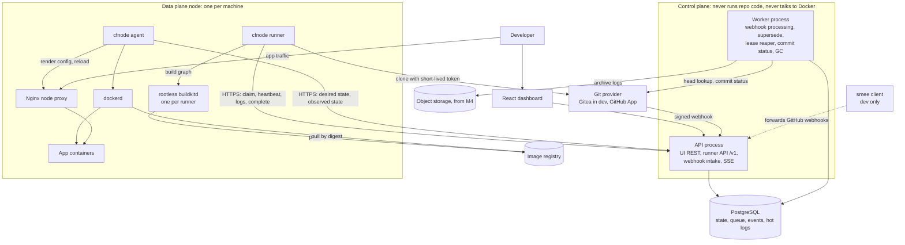
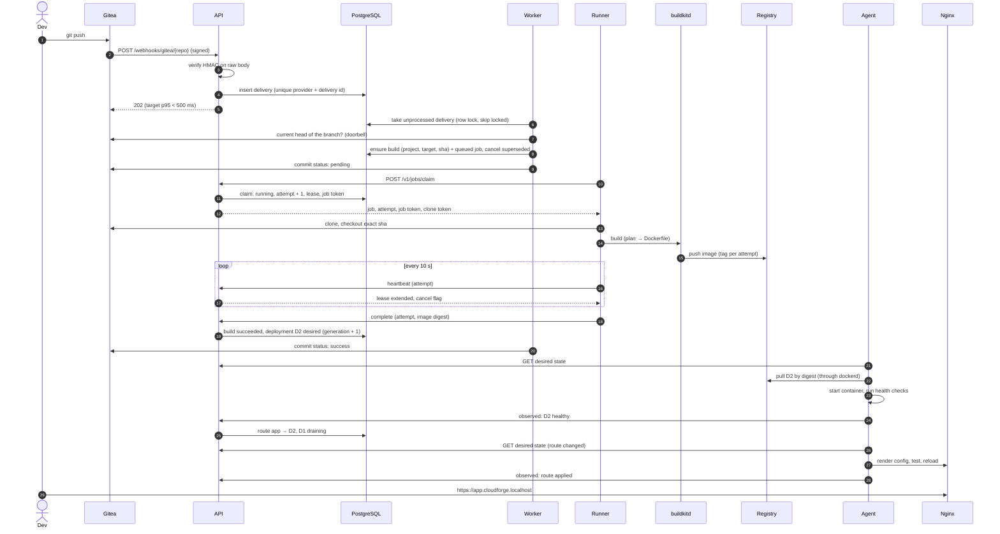
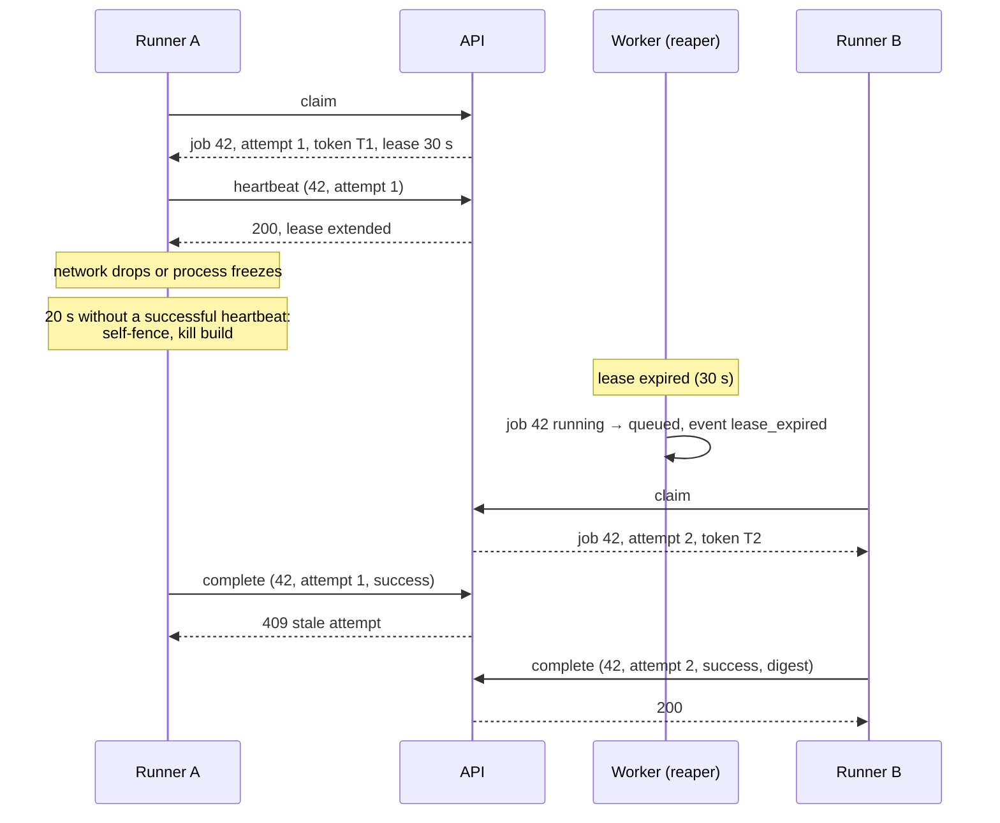

# Architecture overview

Status: accepted 2026-11-05 (Gate B part 1). Section 4 updated in part 2 (log responses, cancel flag). Amended 2026-11-06 by part 3: one rootless buildkitd per runner (ADR-0009), one network per environment (ADR-0010). Section 4 paths updated 2026-11-06 to the accepted node API contract (Gate C parts 2a and 2b). Evidence for labels: `docs/research/gate-a.md`.

## 1. Architecture

Changes from the draft in `docs/spec.md` 5.3, all `[OUR DECISION]`:

1. No separate scheduler process. A claim happens inside the runner's own API request (ADR-0003). The reaper, supersede, webhook processing and commit statuses run as loops in one Worker process.
2. The webhook endpoint is a route of the API process, not its own service. It only verifies, stores and returns (ADR-0004).
3. The runner talks only to `buildkitd`, never to `dockerd`. Only the agent touches `dockerd`. Tests run as a build stage (ADR-0008).
4. The agent owns its node's proxy config: it renders the file and reloads Nginx. Runbot does the same per builder `[SOURCE]` (ADR-0005).
5. Only the Worker posts commit statuses, and only from accepted results. A zombie runner can't post (ADR-0003).
6. Object storage arrives in M4 (log archive). If the runner ever uploads artifacts, it gets presigned URLs scoped to its job, never storage credentials.

## 2. Components

| Component | Runs as | Responsible for | Must never |
|---|---|---|---|
| API | container `api` (FastAPI) | UI REST, runner API `/v1`, webhook intake, SSE log streams, every state transition | run repo code, talk to Docker, do slow work inside a request |
| Worker | container `worker`, same image | stored webhooks → builds, supersede, lease reaper, commit statuses, GC, log archive | serve HTTP |
| PostgreSQL | container | single source of truth: state, job queue, events, hot log chunks | hold images, artifacts or unbounded logs |
| cfnode runner | one per node | register, poll, claim, heartbeat, clone the exact SHA, detect and plan, drive buildkitd, push, stream logs, report | execute repo code in its own process, hold long-lived Git or registry admin credentials |
| cfnode agent | one per node (same Go binary) | poll desired state, reconcile app containers (found by label), health checks, render and reload node proxy, report observed state | decide what should run |
| buildkitd | rootless container per runner, reached only through a Unix socket shared with that runner (ADR-0009) | execute the build graph in its own sandboxed containers; layer cache | be reachable from app containers or over TCP; share its cache across organizations or pools |
| Registry | container | images by digest | accept pushes from app containers |
| Nginx | container per node | route by `Host` header to app containers; joins every environment's own network (ADR-0010) | expose app containers directly |

## 3. Webhook to URL

## 4. Runner and agent protocol (conceptual)

Exact paths and schemas: `contracts/v1.yaml`. Status code meanings are fixed here.

| Call | Auth | Purpose | Responses |
|---|---|---|---|
| `POST /v1/runners/register` | one-time registration token | exchange for a runner credential | 201 credential; 401 token used or expired |
| `POST /v1/jobs/claim` | runner credential | get one job if the runner has a free slot | 200 job; 204 nothing |
| `POST /v1/jobs/{id}/attempts/{n}/heartbeat` | job token + attempt | extend lease, learn about cancel | 200 lease + cancel flag; 409 stale attempt |
| `POST /v1/jobs/{id}/attempts/{n}/logs` | job token + attempt | append a log chunk with sequence number | 202, also for a repeated sequence; 409 stale; 413 chunk or log too big; 416 gap, body has `expected_seq` (ADR-0006) |
| `POST /v1/jobs/{id}/attempts/{n}/steps` | job token + attempt | step status (clone, detect, build, test, push) | 200; 409 stale |
| `POST /v1/jobs/{id}/attempts/{n}/complete` | job token + attempt | final result + image digest | 200, also for an identical repeat; 409 stale or different result |
| `POST /v1/jobs/{id}/attempts/{n}/release` | job token + attempt | give the job back (graceful shutdown) | 200; 409 stale |
| `POST /v1/nodes/register` | one-time registration token | exchange for an agent credential | 201 credential; 400 name taken; 401 token used or expired |
| `GET /v1/nodes/me/desired` | agent credential | networks, deployments, routes, generation | 200 |
| `POST /v1/nodes/me/observed` | agent credential | health per deployment, routed deployments, applied generation | 200 |

Rules:
- `409` always means "you are fenced: stop this job and kill its containers". `401` means bad credential.
- Every `2xx` answer to a job-scoped call (heartbeat, logs, steps) carries the cancel flag, as GitLab does with its `Job-Status` header `[SOURCE]`. While logs flow, a cancel reaches the runner in about 1 s; otherwise within one heartbeat (10 s).
- Runner and agent credentials are separate, because desired state contains runtime secrets that a runner must not read.

