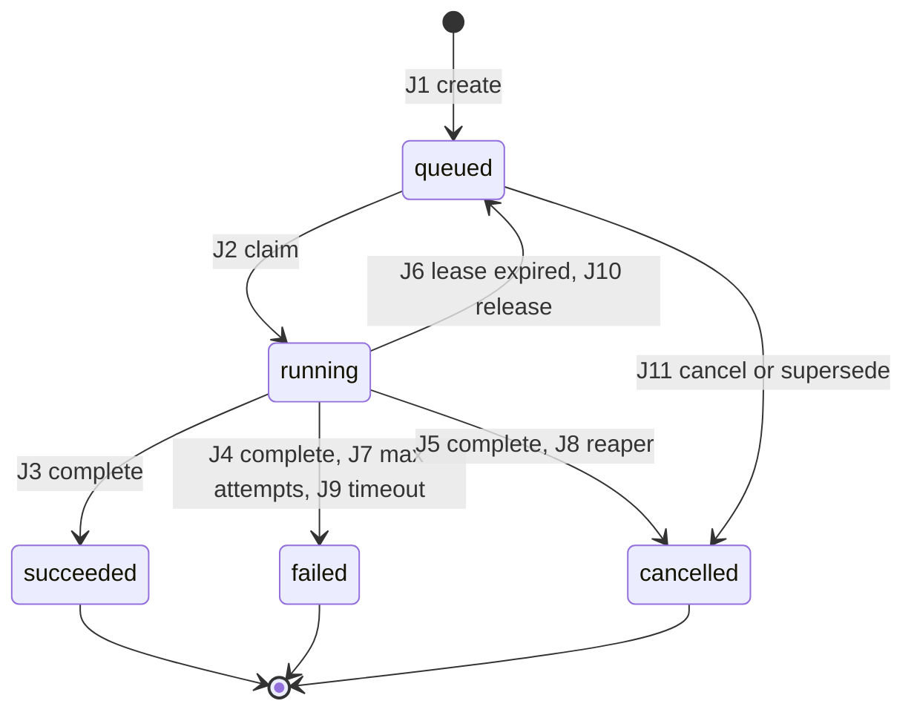
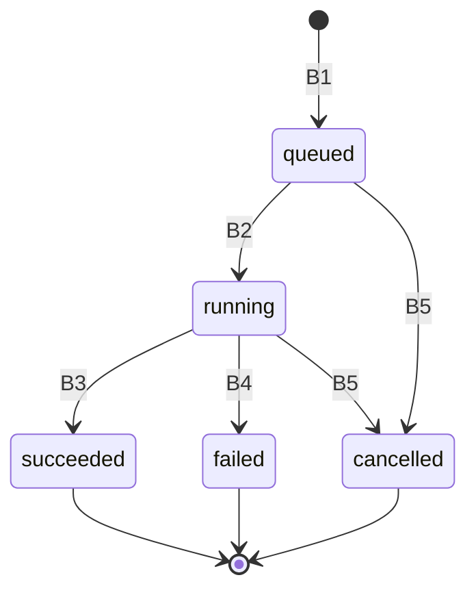
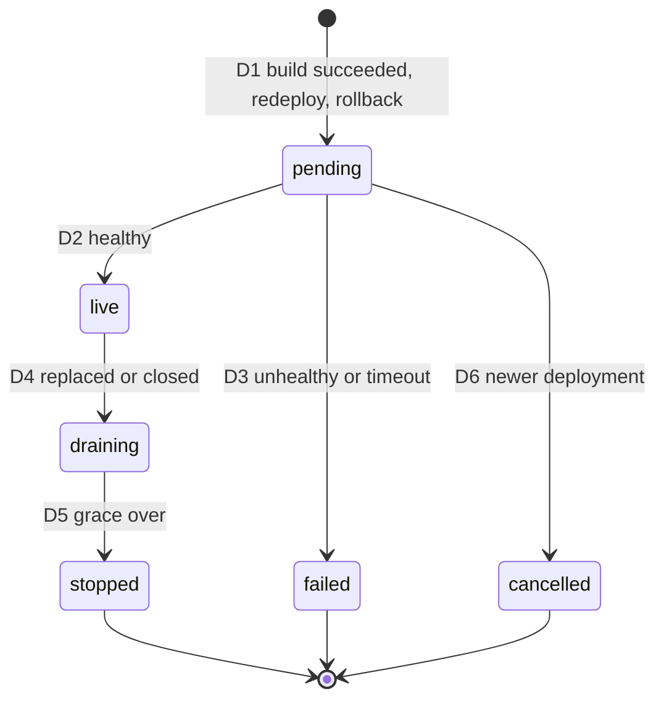
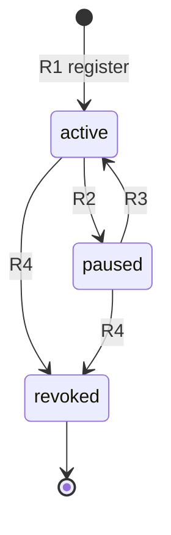

# State machines

Status: accepted 2026-11-06 (Gate B part 2 of 3). Amended 2026-11-06 by part 3: D1 guard checks that the build matches the environment (ADR-0013).
The Build and Job state machines, with the lease logic, are YOU BUILD IT in M2. These tables are what your code and the M2 tests check, not the code itself. Timings come from ADR-0003.

## Common rules

1. A state is a decision the control plane made. Facts reported from outside are stored as observations with timestamps, not as states. Examples: a runner is online, a container is healthy, a route is applied. So no reaper ever has to "mark something offline".
2. Every transition is one compare-and-set: `UPDATE ... SET state = :to WHERE id = :id AND state = :from`. Zero rows updated means someone else moved first. The caller then answers 409 or does nothing; it never retries blindly.
3. The same transaction inserts one event row with the entity id, from, to, a reason code, the actor (`user:<id>`, `runner:<id>`, `agent:<node>`, `worker`) and database time. Job events also record the attempt.
4. The database backs this up. A `CHECK` lists the valid states. One trigger function rejects any (old, new) pair missing from an allowed-transition table. That table is generated from the same transition map the Python service uses, and a unit test compares the two.
5. Terminal states are final. Trying the same commit again means a new Build (rebuild) or a new Deployment (redeploy, rollback).

## Job

Reminder: one job row per build, and `attempt` counts the claims (ADR-0003).

| # | From → to | Trigger | Actor | Guard | Also in the same transaction |
|---|---|---|---|---|---|
| J1 | new → queued | build created | Worker (webhook), API (manual, rebuild) | none | B1 |
| J2 | queued → running | claim | API, inside the runner's claim request | runner active; labels satisfied; runner under capacity; row locked with `SKIP LOCKED` | attempt + 1; runner set; lease = `now()` + 30 s; deadline = `now()` + build timeout; new job token (hash stored); B2 on attempt 1 |
| J3 | running → succeeded | complete, success | runner | job id, attempt and token match | B3 with the digest |
| J4 | running → failed | complete, failure | runner | match | B4 (`step_failed:<step>` or `timeout`) |
| J5 | running → cancelled | complete, cancelled | runner | match; cancel was requested | B5 |
| J6 | running → queued | lease expired | Worker reaper | attempt < max; no cancel requested | clear runner and token; close this attempt's open steps as failed (`lease_expired`) |
| J7 | running → failed | lease expired | reaper | attempt = max | B4 (`lease_expired_max_attempts`) |
| J8 | running → cancelled | lease expired | reaper | cancel was requested | B5 |
| J9 | running → failed | deadline passed by 1 min | reaper | none | B4 (`timeout`). The runner's next call gets 409 and it kills the build. |
| J10 | running → queued, or failed at max | release | runner | match | like J6; at max like J7 with `released_max_attempts` |
| J11 | queued → cancelled | cancel or supersede | API (user), Worker (supersede) | none | B5 (`user_cancelled` or `superseded`) |

Not transitions, because the state doesn't change:

- **Heartbeat**: lease = `now()` + 30 s. No event row; one every 10 s would drown the history.
- **Cancel request on a running job**: sets `cancel_requested_at` and records a `cancel_requested` event. The runner sees the flag in its next response (overview, section 4) and ends with J5. If the runner is gone, J8 ends it.
- **Repeated identical complete**: 200, nothing written (ADR-0003 rule 6).

Two timeouts, one owner each. The runner enforces the build timeout and reports a failure (J4), so the user gets a clean log. The reaper's J9 is only the backstop for a runner that keeps heartbeating but never finishes.

## Build

Forward only. While a job is retried, its build stays `running` and the UI shows "attempt 2 of 3".

| # | From → to | Caused by |
|---|---|---|
| B1 | new → queued | J1 |
| B2 | queued → running | J2, first attempt only |
| B3 | running → succeeded | J3; sets `image_digest` |
| B4 | running → failed | J4, J7, J9, or J10 at max; the reason is copied from the job |
| B5 | queued or running → cancelled | J5, J8, J11 |

Why Build and Job are separate tables when their states look alike:

- Build is history for people: commit, target, trigger, steps, result. It never goes backwards.
- Job is the scheduler's working row: lease, token, runner, attempt. It is rewritten every 10 s while running. Keeping those writes off the build row keeps the history row stable.
- They stay one-to-one until a build needs several jobs.

## Deployment

| # | From → to | Trigger | Actor | Guard | Also in the same transaction |
|---|---|---|---|---|---|
| D1 | new → pending | build succeeded for an environment that auto-deploys; or a user redeploys or rolls back | Worker, API | the build succeeded (data-model.md, composite key); the build matches the environment: same project, same target, and trusted if the environment is production or staging (ADR-0013) | node's desired generation + 1; an older pending deployment of the environment → cancelled (D6) |
| D2 | pending → live | agent reports it healthy | API, on the observed-state report | the report is for the current generation | old live deployment → draining (D4) first, then this one → live; route = this deployment; generation + 1 |
| D3 | pending → failed | agent reports health failed, container exited or pull failed; or pending for more than 10 min | API, Worker | none | removed from desired state; the route doesn't move, so the old live deployment keeps serving |
| D4 | live → draining | a newer deployment went live (D2), or the environment closed (PR closed, M7) | API, Worker | none | route moves or disappears; generation + 1 |
| D5 | draining → stopped | grace period over | Worker | `route_applied_at` + 30 s < `now()` | removed from desired state; the image is kept for rollback (retention, M8) |
| D6 | pending → cancelled | newer deployment created, or environment closed | Worker, API | none | removed from desired state |

Three details matter:

- The grace timer starts when the agent reports the new route applied, not when the control plane decides. Otherwise the old container could stop while Nginx still sends it traffic.
- Inside D2, the old deployment leaves `live` before the new one enters it. PostgreSQL checks a non-deferrable unique index whenever a row is inserted or modified, not at the end of the transaction `[DOCS]` (https://www.postgresql.org/docs/current/sql-createtable.html).
- Health is an observation, not a state. A live deployment that turns unhealthy stays `live`: the agent restarts it, the dashboard shows it as unhealthy, and rollback is the user's decision. M6 may add automatic rollback.

## Runner

States record what an admin decided. Liveness is a fact: `last_seen_at`, updated by any authenticated runner call, at most once every 5 s per runner. "Online" means seen in the last 30 s. GitLab also derives online, offline and stale from `contacted_at` instead of storing them `[SOURCE]` (gitlab `app/models/ci/runner.rb:66-80, 454-461`).

| # | From → to | Trigger | Actor | Guard | Also in the same transaction |
|---|---|---|---|---|---|
| R1 | new → active | register with a one-time token | API | token unused and unexpired | token marked used; credential returned once, hash stored |
| R2 | active → paused | admin pauses | API (user) | none | claims now answer 204; running jobs finish |
| R3 | paused → active | admin resumes | API (user) | none | none |
| R4 | active or paused → revoked | admin revokes (this is deregistration) | API (user) | none | the credential gets 401 from now on; its running jobs come back through their leases, with no special path |

Graceful shutdown is local to the runner: stop claiming, let running jobs finish up to a shutdown timeout, release the rest (J10), exit.

Spec 9 also says "deregister" on shutdown. `[OUR DECISION]`: we don't. The runner is a long-lived node service and registration tokens are one-time, so deregistering on every restart would need a new token each time. Deregistration is R4.

A node (the agent) uses the same register and revoke steps (R1, R4) with its own token kind, and has no pause.

## Build steps (no transition table)

- The runner reports a step when it starts and when it ends: `running` → `succeeded`, `failed`, `cancelled` or `skipped`.
- Steps are keyed by (build, attempt, name), so attempt 1's steps stay visible after attempt 2 starts.
- When an attempt ends without the runner (J6 to J9), that attempt's open steps are closed as `failed` with the job's reason.
- Which steps exist and how they map to BuildKit: ADR-0008.
