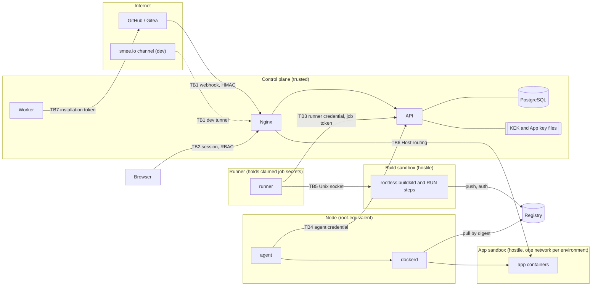

# Threat model (STRIDE)

Status: accepted 2026-11-06 (Gate B part 3). Amended 2026-11-06 by Gate C part 2c (ADR-0015): threats 5 and 6, new threat 31. Amended 2026-11-06 by the M1 lab: threat 16, new threat 32.

- Reviewed again in M8 (spec 19).
- Update it whenever a trust boundary changes.
- STRIDE: Spoofing, Tampering, Repudiation, Information disclosure, Denial of service, Elevation of privilege.

## 1. Assets

| Asset | Where | Worst case |
|---|---|---|
| Secret values (variables) | PostgreSQL, encrypted (ADR-0007) | read by another tenant or a fork author |
| KEK | files in `/run/secrets` (api, worker) | together with a database dump: every secret |
| GitHub App private key | files in `/run/secrets` (api, worker) | read every installed repository |
| mkcert CA key (M8) | host only | impersonate any website to this machine's browsers |
| Source code and images | Git provider, runner checkout, registry | read by another tenant; a poisoned image deployed |
| Build and deploy integrity | job and deployment rows, registry digests | an attacker's image runs as production |
| Logs | PostgreSQL chunks, object storage | a secret printed and kept |
| Availability | runners, nodes, PostgreSQL | builds starved; host disk or RAM exhausted |

## 2. Attackers

| Id | Who | Starting point |
|---|---|---|
| A1 | hostile repository content, including a malicious dependency | runs inside a build or an app (spec 16: every repository) |
| A2 | fork PR author | can open PRs, has no access to the project |
| A3 | another tenant | member of another organization on the same CloudForge |
| A4 | low-role member | viewer or developer of the organization |
| A5 | network attacker | on the path of webhooks, or between runner/agent and API once they leave the host (M9) |
| A6 | compromised runner or node | after a container escape |

## 3. Trust boundaries

| Id | Boundary | Crossed by |
|---|---|---|
| TB1 | Internet → webhook intake | GitHub, Gitea, the dev tunnel |
| TB2 | Browser → API | users |
| TB3 | Runner → API | runner credential, job token |
| TB4 | Agent → API | agent credential |
| TB5 | Hostile build → runner, buildkitd, network | RUN steps |
| TB6 | Hostile app → node, other environments, network | app containers |
| TB7 | Control plane → Git provider | installation tokens |
| TB8 | Operator files → host | KEK, App key, CA key |

## 4. Threats and mitigations

Verified by: the milestone whose tests prove the mitigation.

| # | TB | STRIDE | Threat | Mitigation | Verified by | Residual |
|---|---|---|---|---|---|---|
| 1 | TB1 | S | forged webhook starts builds | HMAC over the raw body, constant-time compare, unsigned requests rejected (ADR-0004) | M3 | none known |
| 2 | TB1 | T, R | replayed or duplicated delivery | unique (provider, delivery id); dedup on (project, target, SHA) (ADR-0004) | M3 break-it: 50 replays | none known |
| 3 | TB1 | D | webhook flood | the intake is one INSERT; per-IP rate limit at Nginx (M8) | M3 load test | large floods need filtering upstream |
| 4 | TB1 | I | smee channel URL leaks delivery contents | new channel, URL kept out of the repository (ADR-0011) | none | accepted for dev only |
| 5 | TB2 | S | stolen password or session | scrypt hashes; `HttpOnly`, `SameSite=Strict`, host-only session cookie, `Secure` from M8 (ADR-0015) | M4 | no MFA |
| 6 | TB2 | T | cross-site request changes state | writes need `Sec-Fetch-Site: same-origin` or a matching `Origin`; `SameSite=Strict` cookie (ADR-0015) | M4 | none known |
| 7 | TB2 | E | low-role member edits variables or approves a fork PR | role check per endpoint; fork approval needs owner or admin (ADR-0013) | M4 RBAC tests | none known |
| 8 | TB2 | I | tenant reads another organization's builds, logs, images or deployments | organization filter on every query; tenant isolation suite (spec 16) | M4 | a missed filter is a bug; row-level security is an optional backstop |
| 9 | TB2 | I | secret value read back | values are write-only in API and UI (ADR-0007) | M4 | none known |
| 10 | TB3 | S | rogue runner registers | one-time registration tokens with expiry; credentials stored as hashes (ADR-0003, ADR-0007) | M2 | a leaked unused token works until it expires |
| 11 | TB3 | T | zombie or stale attempt overwrites a result | fencing: attempt plus job token, 409 (ADR-0003) | M2 chaos 2, 7 | side effects outside the API (ADR-0003) |
| 12 | TB3 | I | runner reads other projects' secrets | claim returns only the claimed job's build variables; one organization per runner; untrusted pool gets none (ADR-0007, ADR-0009) | M4 | inside one organization, a compromised runner collects that organization's build secrets over time |
| 13 | TB3, TB4 | I | credentials or secrets sniffed once runner or agent leave the host | TLS required off-host (ADR-0007) | M9 | none known |
| 14 | TB3 | D | runner floods logs | 64 KiB per chunk, 10 MiB per attempt (ADR-0006) | M4 | none known |
| 15 | TB4 | I | stolen agent credential reads runtime secrets | desired state only for that node; credential revocable (R4) | M6 | a node holds its own deployments' secrets by design |
| 16 | TB5 | E | escape from a RUN step | rootless BuildKit as uid 61000, which no person has; default seccomp per RUN; no socket; no `--privileged` (ADR-0009, ADR-0012) | M1 lab (done), M8 | kernel bugs (one kernel) |
| 17 | TB5 | I | build sends its own secrets out | only that build's own secrets exist there; masking is best effort | none | accepted: hostile code can leak secrets given to it (ADR-0007) |
| 18 | TB5 | I, T | build reaches control plane, database, metadata IP or other containers | iptables egress rules (ADR-0012) | M8 hostile fixtures | none known |
| 19 | TB5 | T | build poisons another tenant's cache mount | buildkitd per runner; runners per organization and pool (ADR-0009) | M5 | inside one organization and pool: possible with a hand-written Dockerfile |
| 20 | TB5 | D | fork bomb, memory, disk fill, endless build | pids, memory and CPU limits; fixed-size filesystem; timeouts (ADR-0012) | M5 break-it | starves that runner's other builds, not the host |
| 21 | TB5 | T | zombie build pushes after it was fenced | per-attempt tags; digest only from an accepted complete (ADR-0003, ADR-0008) | M2 | none known |
| 22 | TB6 | E | escape from an app container | cap-drop ALL, no-new-privileges, non-root, read-only rootfs, seccomp and AppArmor (ADR-0012) | M8 | kernel bugs; gVisor evaluated in M9 |
| 23 | TB6 | I, T | preview reaches production or another tenant directly | one network per environment (ADR-0010) | M7, M8 fixtures | none known |
| 24 | TB6 | S | preview served under a production hostname | each hostname belongs to one environment; deployment guard (ADR-0013) | M7 | none known |
| 25 | TB6 | D | app eats the node | per-kind limits; read-only root plus tmpfs (ADR-0012, ADR-0013) | M6 | disk I/O and bandwidth are not limited |
| 26 | TB7 | I | installation token leaks | one repository, `contents: read`, at most 1 hour (ADR-0011) | M3 | valid until it expires |
| 27 | TB8 | E | App private key stolen | only in api and worker; rotate through GitHub (ADR-0011) | none | full access to installed repositories until rotated |
| 28 | TB8 | I | database dump and KEK leak together | stored apart; leaked values rotated at their source (ADR-0007) | none | every secret value is exposed |
| 29 | TB8 | E | mkcert CA key leaks | never in a container or the repository (ADR-0010) | M8 | none known |
| 30 | registry | I | stolen runner credential pulls other organizations' images | htpasswd in M1, job-scoped token auth in M8 (ADR-0009) | M8 | stub until M8 |
| 31 | TB6 | S, T | a hostile app's page sends requests to the dashboard with the user's cookies | the dashboard is a different site from the apps; same-origin check on writes (ADR-0015) | M7 fixture | a public install with apps and dashboard on one registrable domain loses the site separation |
| 32 | TB5 | I | a hostile Dockerfile names a registry whose auth challenge sends the runner's token request to an internal URL (BuildKit fetches tokens in its client, `docs/operations/local-setup.md`) | the runner's session gives buildkitd only credentials for our registry and no token authority, so buildkitd fetches tokens itself, from cf-build (to verify in M1 slice 3) | M1 slice 3 test, M8 | buildkitd's own requests: egress rules (ADR-0012) |

## 5. Top residual risks

1. **One kernel for everything.** A kernel exploit from any build or app owns the host. Next step: the M9 evaluation of gVisor, Kata and Firecracker.
2. **Hostile code can leak what it is given.** Build secrets reach the build, and masking is best effort.
3. **Within one organization:**
   - a compromised runner collects build secrets over time;
   - a hand-written Dockerfile can poison another project's cache mount.
4. **Registry credentials are shared until M8.**
5. **The `docker` group and the agent are root-equivalent on each node.**

## 6. Security tests by milestone

| Milestone | Tests |
|---|---|
| M1 | the runner's session offers no token authority (threat 32) |
| M2 | fencing chaos scenarios |
| M3 | webhook signature, replay and out-of-order events |
| M4 | tenant isolation suite, RBAC, write-only secrets, job-scoped secrets |
| M5 | hostile build fixtures: fork bomb, huge log, disk fill, Docker socket probe |
| M7 | preview isolation, fork PR flow, a hostile app calling the dashboard |
| M8 | network fixtures (metadata IP, other containers, control plane), the full suite, review of this document |
